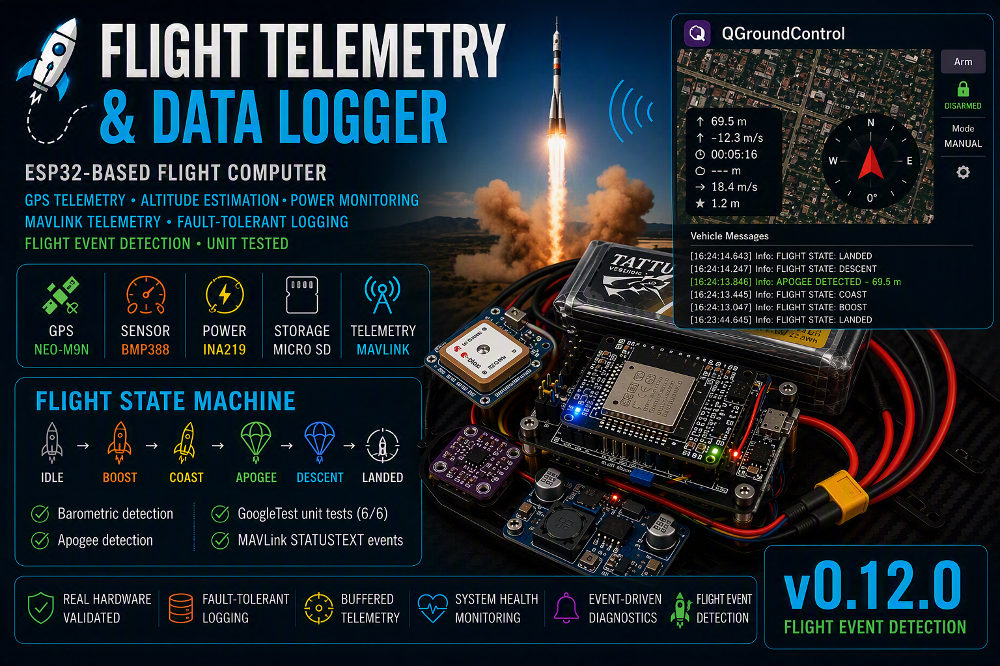
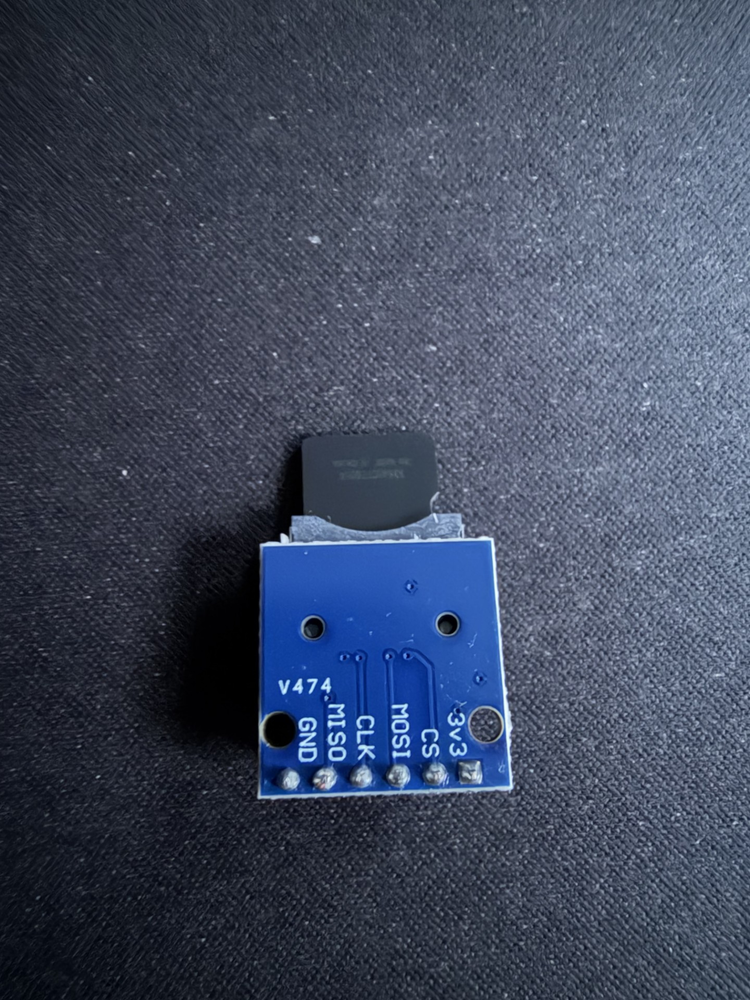
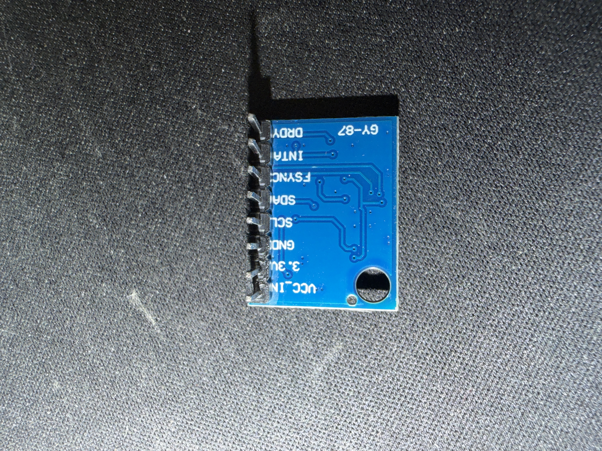
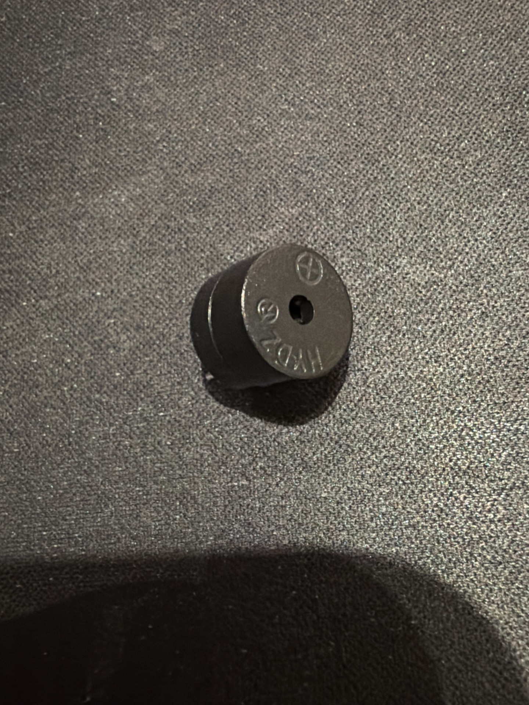
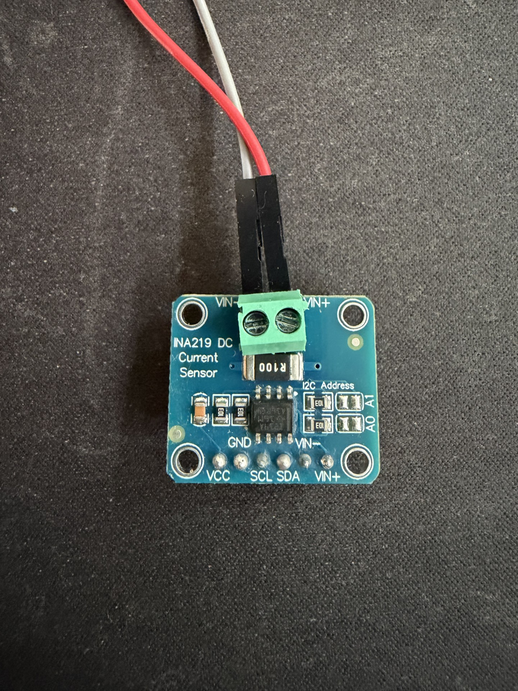
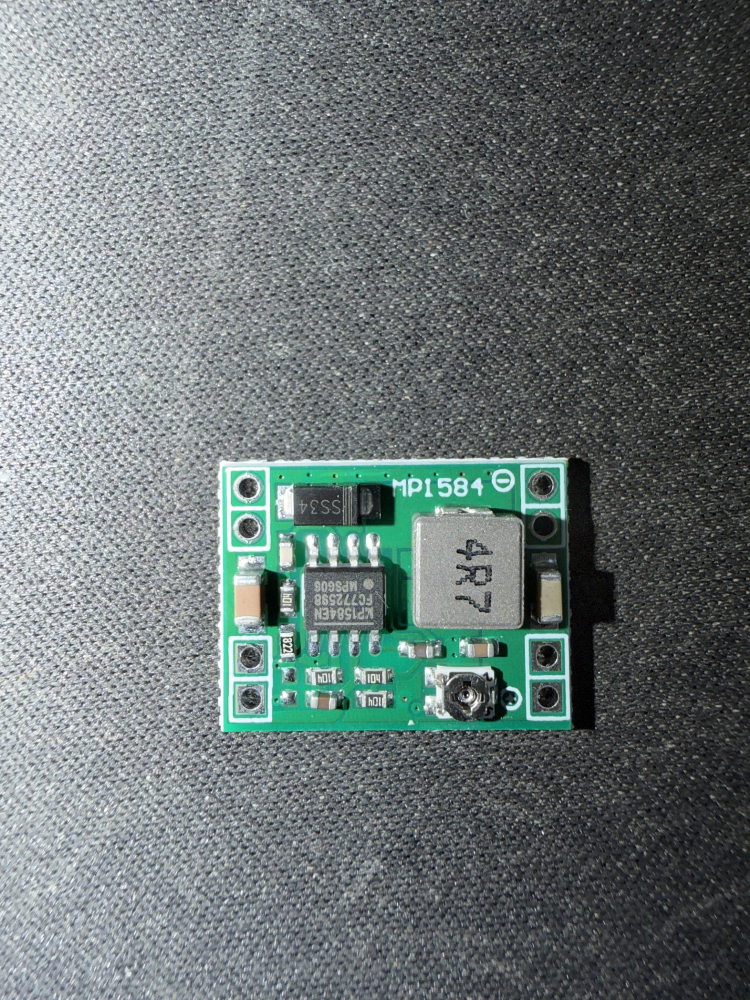
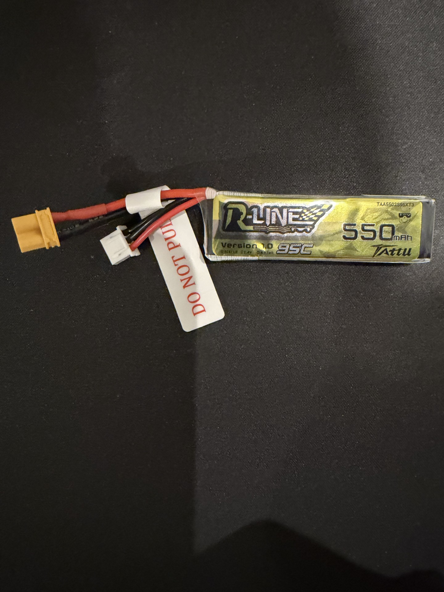
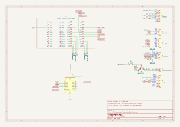
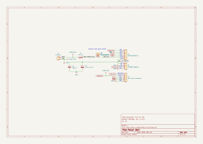

# RocketOS

Open-source ESP32-S3 flight computer, telemetry, data-logging and validation platform for experimental model rockets.




---

## Project Status

RocketOS is currently at the **Mk1 prototype integration stage**.

The project has progressed from an ESP32 DevKitC development prototype to an ESP32-S3 N16R8 Mk1 architecture with two longitudinal prototype PCBs:

- **Main Deck v0.1 — 30 × 85.5 mm**
- **Power Deck v0.1 — 30 × 85.5 mm**

Both PCB designs have been released for prototype fabrication.

The current ESP32-S3 firmware builds successfully and the native regression suite passes **9/9 tests**.

The Mk1 electrical configuration is now being reproduced and validated on the bench before physical PCB bring-up.

Bench validation has confirmed simultaneous shared-I2C operation of:

- INA219 at `0x40`.
- GY-87 MPU-6050 at `0x68`.
- External BMP388 at `0x76`.
- GY-87 BMP180 at `0x77`.

The external BMP388 address was changed from its default `0x77` to `0x76` to resolve the address collision with the BMP180 present on the GY-87.

The fabricated Mk1 PCBs have **not yet been physically brought up or flight validated**.

---

## What RocketOS Does

RocketOS currently provides:

- Barometric altitude measurement.
- GPS position, altitude, speed and time.
- Autonomous flight-state detection.
- MicroSD flight logging.
- Buffered recovery from temporary SD write failures.
- Battery monitoring.
- Runtime system-health monitoring.
- Audible flight and system events.
- MAVLink telemetry over USB Serial.
- Flight-profile replay testing.
- Native automated regression tests.
- Serial replay on physical ESP32 hardware.

The target Mk1 ecosystem additionally includes:

- LoRa telemetry.
- GY-87 inertial sensing.
- Recovery actuation.
- Dedicated RocketOS Ground Station.
- Post-flight Flight Analyzer.

These target functions are not all implemented yet.

---

## Mk1 Hardware

### Main Deck v0.1

The Main Deck is based on the **ESP32-S3 N16R8** and provides interfaces for:

| Component | Model | Function |
|---|---|---|
| Microcontroller | ESP32-S3 N16R8 | Flight computer |
| GNSS | u-blox NEO-M9N | Position, altitude, speed and UTC |
| Barometer | BMP388 at I2C `0x76` | Pressure, temperature and altitude |
| Storage | MicroSD | Flight-data logging |
| IMU module | GY-87 | Future inertial sensing |
| Radio | Ai-Thinker Ra-02 / SX1278 | Future LoRa telemetry |
| Audible feedback | Active buzzer | Status and recovery beacon |

The external BMP388 is fixed at I2C address **`0x76`** by tying SDO to GND. This avoids the **`0x77`** address used by the BMP180 present on the Mk1 GY-87 module.

The already-released Main Deck v0.1 fabrication package predates this correction and leaves BMP388 SDO unconnected. Fabricated v0.1 boards therefore require an **SDO-to-GND rework** during assembly. The current KiCad source includes the corrected connection.

Main Deck envelope:

```text
30 × 85.5 mm
```

#### Main Deck module references

| ESP32-S3 N16R8 | BMP388 | NEO-M9N |
|---|---|---|
|  |  |  |

| MicroSD | GY-87 | Ra-02 / SX1278 |
|---|---|---|
|  |  |  |

| Active buzzer |
|---|
|  |

### Power Deck v0.1

The Power Deck provides:

- XT30 battery input.
- 2 A resettable protection fuse.
- Main power switching.
- INA219 voltage/current monitoring.
- MP1584 regulation.
- 5 V output to the Main Deck.
- INA219 I2C connection to the Main Deck.
- Bulk and local decoupling.

Power Deck envelope:

```text
30 × 85.5 mm
```

#### Power Deck module references

| INA219 | MP1584 |
|---|---|
|  |  |

### Battery

Current Mk1 development battery:

```text
Tattu 2S 550 mAh LiPo
7.4 V nominal
8.4 V maximum
```



The battery is mechanically retained independently of the PCBs.

### Mk1 Schematics

The current Mk1 electrical architecture is split between two longitudinal PCBs.

#### Main Deck v0.1



#### Power Deck v0.1



The schematic SVGs are exported from the current KiCad source.

Earlier `flighttelemetry-v*.png` schematics are retained in `docs/schematics/` for historical traceability and do not represent the current Mk1 architecture.

---

## Mk1 Architecture

```text
                     2S LiPo
                        |
                        v
              +-------------------+
              |    Power Deck     |
              |                   |
              | PPTC Protection   |
              | Main Switch       |
              | INA219            |
              | MP1584            |
              +---------+---------+
                        |
               +5V / I2C / GND
                        |
                        v
              +-------------------+
              |     Main Deck     |
              |                   |
              | ESP32-S3 N16R8    |
              | BMP388 @ 0x76     |
              | NEO-M9N           |
              | MicroSD           |
              | GY-87             |
              | Ra-02 / SX1278    |
              | Active Buzzer     |
              +---------+---------+
                        |
              +---------+---------+
              |                   |
              v                   v
          SD Logging       Flight Processing
                                  |
                         +--------+--------+
                         |                 |
                         v                 v
                   USB MAVLink       LoRa Transport
                   implemented          planned
```

The two PCBs are designed for longitudinal installation in a mechanical sled.

The final sled geometry remains under development.

---

## Mk1 GPIO Baseline

| Function | ESP32-S3 GPIO |
|---|---:|
| GPS RX | 17 |
| GPS TX | 18 |
| I2C SDA | 8 |
| I2C SCL | 9 |
| SPI MOSI | 11 |
| SPI MISO | 13 |
| SPI SCK | 12 |
| MicroSD CS | 5 |
| LoRa NSS | 10 |
| LoRa RESET | 14 |
| LoRa DIO0 | 15 |
| Buzzer control | 21 |

MicroSD and LoRa share the SPI bus and use independent chip-select signals.

Integrated MicroSD + LoRa operation still requires bench validation.

DS18B20 support remains in the firmware but is disabled in the current Mk1 configuration.

---

## Mk1 I2C Baseline

The Mk1 shared I2C bus has been bench validated with the current module set:

| Device | Address | Status |
|---|---:|---|
| INA219 | `0x40` | Detected |
| GY-87 MPU-6050 | `0x68` | Detected and identified |
| External BMP388 | `0x76` | Detected and flight-firmware validated |
| GY-87 BMP180 | `0x77` | Detected and identified |

The external BMP388 uses SDO tied to GND to select address `0x76`.

This establishes electrical coexistence on the shared bus. GY-87 sensor acquisition is not yet integrated into the flight firmware.

---

## Flight-State Detection

RocketOS implements the following flight-state sequence:

```text
IDLE -> BOOST -> COAST -> APOGEE -> DESCENT -> LANDED
```

Detection currently uses BMP388 barometric altitude and derived climb rate.

This provides **flight-event detection**, not recovery deployment control.

Recovery actuation remains planned.

---

## Logging

RocketOS currently supports:

- Automatic CSV log creation.
- GPS timestamp filenames when GPS time is available.
- Boot-number filename fallback.
- Flight and sensor data recording.
- SD startup self-test.
- Runtime SD failure detection.
- 100-record RAM FIFO.
- Ordered recovery after temporary SD failures.
- Runtime event logging.

Onboard logging operates independently from the telemetry transport.

---

## Telemetry

### MAVLink

MAVLink telemetry is currently implemented over USB Serial.

Implemented messages include:

| Message | Purpose |
|---|---|
| HEARTBEAT | Vehicle presence and link status |
| SYS_STATUS | System and battery status |
| GPS_RAW_INT | GNSS position and fix |
| GLOBAL_POSITION_INT | Position and relative altitude |
| GLOBAL_POSITION_INT_COV | Position with covariance |
| VFR_HUD | Speed, altitude and climb rate |
| BATTERY_STATUS | Battery voltage, current and SOC |
| HOME_POSITION | Home reference |
| STATUSTEXT | System and flight events |

### LoRa

Mk1 radio hardware:

```text
Ai-Thinker Ra-02
SX1278-class
```

The radio interface is present in the Main Deck v0.1 hardware design.

LoRa transport is **not yet implemented in the flight firmware**.

---

## Flight Profile Replay Testing

RocketOS supports data-driven testing using altitude-vs-time flight profiles.

```text
CSV flight profile
        |
        v
FlightStateMachine
        |
        v
Detected flight sequence
        |
        v
Expected result validation
```

Current profiles:

| Profile | Expected Apogee | Purpose |
|---|---:|---|
| `estes_c6` | 253.9 m | Nominal flight |
| `midpower_machdip` | 904.4 m | Barometric Mach-dip rejection |
| `low_apogee` | 71.5 m | Low-altitude flight |

Current native regression result:

```text
9 test cases
9 succeeded
```

The suite contains:

- 3 flight-profile tests.
- 6 flight-state-machine tests.

Run it with:

```bash
cd firmware/flight-computer
pio test -e native
```

If PlatformIO is not available globally on Windows, the project development environment can be invoked directly:

```powershell
& "$env:USERPROFILE\.platformio\penv\Scripts\pio.exe" test -d "firmware\flight-computer" -e native
```

---

## ESP32-S3 Firmware

The Mk1 firmware contains an ESP32-S3 N16R8 PlatformIO target.

Build with:

```powershell
& "$env:USERPROFILE\.platformio\penv\Scripts\pio.exe" run -d "firmware\flight-computer" -e esp32s3_n16r8
```

Current validation:

```text
Build: SUCCESS
Tests: 9 / 9 passed
```

Physical hardware identification of the current development module confirmed:

```text
ESP32-S3
240 MHz
16 MB flash
~8 MiB PSRAM
```

Build success does not establish complete Mk1 hardware validation.

---

## Battery Monitoring

The Mk1 BatteryMonitor uses a 2S LiPo baseline:

| Voltage | Estimated SOC |
|---:|---:|
| 8.40 V | 100% |
| 8.20 V | 90% |
| 8.00 V | 80% |
| 7.80 V | 70% |
| 7.60 V | 60% |
| 7.40 V | 50% |
| 7.20 V | 40% / Warning |
| 7.00 V | 25% |
| 6.80 V | 10% / Critical |
| 6.60 V | 0% |

Below 5.0 V is treated as battery disconnected.

Bench validation on the historical development configuration demonstrated:

- USB-powered, LiPo disconnected: approximately 4.10–4.13 V → `DISCONNECTED`.
- 2S LiPo connected: approximately 7.72–7.90 V → `CONNECTED / OK`.

This validates the BatteryMonitor behavior.

It does **not** validate the complete Mk1 Power Deck.

---

## Current Validation Boundary

### Validated

- Core flight firmware.
- ESP32-S3 firmware compilation.
- Physical ESP32-S3 N16R8 module identification.
- Native regression suite: 9/9.
- Flight-state-machine behavior.
- Flight-profile replay.
- Historical physical ESP32 replay.
- 2S BatteryMonitor behavior.
- Main Deck v0.1 PCB design release.
- Power Deck v0.1 PCB design release.
- Mk1 BMP388 on GPIO8/GPIO9 I2C bus.
- Mk1 MicroSD on GPIO11/GPIO12/GPIO13 with GPIO5 CS.
- Mk1 NEO-M9N on GPIO17/GPIO18.
- Shared-I2C electrical coexistence of INA219, MPU-6050, BMP388 and BMP180.
- BMP388 address correction to `0x76`.
- BMP388 + MicroSD + GPS simultaneous flight-firmware startup.
- MicroSD flight-log creation.
- GPS fix acquisition on the Mk1 bench configuration.

### Pending

- Buzzer circuit bench validation.
- Ra-02 bench validation.
- Shared MicroSD + Ra-02 SPI operation.
- Complete Power Deck topology bench validation.
- Main Deck physical PCB bring-up.
- Power Deck physical PCB bring-up.
- GY-87 firmware integration.
- LoRa radio communication.
- Complete integrated Mk1 bench validation.
- Mechanical sled validation.
- Recovery actuation.
- Real-flight validation.

RocketOS Mk1 is therefore a **prototype under integration**, not a flight-qualified system.

---

## Prototype PCB Status

Main Deck v0.1 and Power Deck v0.1 have been released for prototype fabrication.

Manufacturing baseline:

```text
PCB:        FR4
Layers:     2
Size:       30 × 85.5 mm
Thickness:  1.6 mm
Copper:     1 oz
Finish:     Lead-free HASL
Mask:       Green
Silkscreen: White
```

Prototype order:

```text
5 × Main Deck v0.1
5 × Power Deck v0.1
```

The exact manufacturing packages are retained in the repository.

The released Main Deck v0.1 fabrication package leaves BMP388 SDO unconnected. The five fabricated Main Deck v0.1 boards therefore require an **SDO-to-GND rework** when the BMP388 is installed.

The current KiCad source contains the corrected SDO-to-GND connection.

The released v0.1 fabrication package remains unchanged to preserve exact as-built traceability.

Fabrication release does not imply electrical or flight validation.

---

## Repository Structure

```text
RocketOS/
|
+-- docs/
|   +-- Baseline/
|   +-- images/
|   +-- schematics/
|
+-- firmware/
|   +-- flight-computer/
|   +-- hardware-id-test/
|
+-- hardware/
|   +-- Mk1/
|       +-- Main_Deck_Longitudinal_v0.1/
|       +-- Power_Deck_Longitudinal/
|       +-- superseded/
|
+-- README.md
```

The authoritative project baseline is maintained under:

```text
docs/Baseline/
```

Key documents:

- `RocketOS_Master_Context.md`
- `RocketOS_Architecture.md`
- `RocketOS_System_Requirements.md`
- `RocketOS_Project_History.md`

Repository code, repeatable validation evidence and released hardware artifacts take precedence when determining implementation status.

---

## Development Principles

RocketOS prioritizes:

1. Reliability over unnecessary complexity.
2. Commercial modules before unnecessary custom hardware.
3. Validation before optimization.
4. Modularity.
5. Maintainability.
6. Field repairability.
7. Cost awareness.
8. Proven solutions over experimental complexity.

The project intentionally distinguishes between:

```text
IMPLEMENTED
DESIGN RELEASED
BENCH VALIDATED
PHYSICALLY INTEGRATED
FLIGHT VALIDATED
```

These states are not interchangeable.

---

## Next Milestones

The immediate development sequence is:

```text
1. Validate buzzer transistor circuit
2. Validate Ra-02
3. Validate shared MicroSD + Ra-02 SPI bus
4. Validate complete Power Deck topology on the bench
5. Receive and inspect prototype PCBs
6. Bring up fabricated Power Deck
7. Bring up fabricated Main Deck, including BMP388 SDO-to-GND rework
8. Develop and validate longitudinal mechanical sled
9. Integrate GY-87 firmware acquisition
10. Integrate LoRa telemetry firmware
11. Complete integrated Mk1 bench validation
12. Real-flight validation
```

---

## License

MIT License